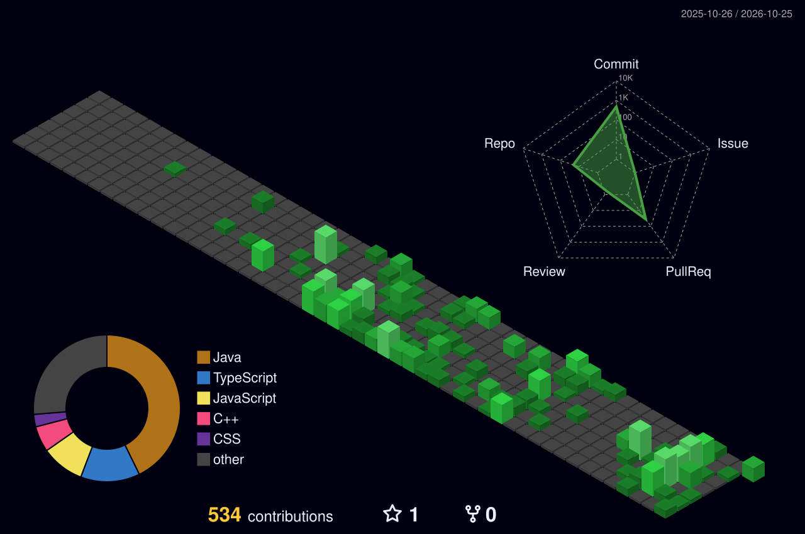

  

  

  
  

  

## 🧑‍💻 About me

- 🎓 Studying and growing every day in the tech field
- 🔭 Currently working on: FitZone
- 🌱 Currently learning: Cloud AWS
- 🤝 Open to collaborating on open source projects
- 💬 Ask me about: **YOUR FAVORITE TOPICS**
- 🐧 Linux user
- 📍 Rio Grande do Sul, Brazil 🇧🇷

## 🛠️ Tech stack & tools

  

<!--## 🏆 Achievements

<!-- 

  

 -->

## 📊 GitHub stats

  
  

  

  

## 💭 Words to code by

  <i>"Talk is cheap. Show me the code."</i> 
  — Linus Torvalds

  <i>"We can only see a short distance ahead, but we can see plenty there that needs to be done."</i> 
  — Alan Turing

## 📫 Let's talk!

  
  
  

  

